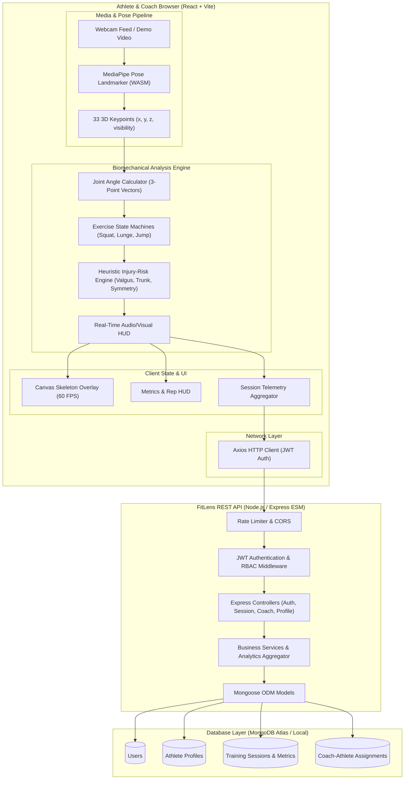

# FitLens System Architecture & Technical Specification

## 1. Executive Summary

**FitLens** is an AI-powered sports performance monitoring and injury-risk assessment web application. It performs real-time body pose estimation through the athlete's browser webcam or recorded video, calculates biomechanical metrics (joint angles, range of motion, repetition cadence, lateral symmetry), detects movement anomalies (e.g. knee valgus collapse, excessive trunk lean, asymmetrical weight shifts), and logs structured session performance telemetry to a secure cloud-backed backend.

> **Disclaimer**: FitLens is an educational and performance-coaching support system. It does not provide medical diagnoses or replace licensed sports medicine clinicians or physical therapists.

---

## 2. Technology Stack & Justification

| Layer | Technology | Justification & Role |
| :--- | :--- | :--- |
| **Language** | **Pure JavaScript (ES2023+ / ESM)** | Consistent runtime across browser and Node.js without compilation overhead. Type-checking supported via clean JSDoc annotations. |
| **Frontend Framework** | **React 18/19 + Vite** | High-performance HMR, lightweight bundle size, rapid canvas and video stream rendering cycles. |
| **Styling & UI** | **Tailwind CSS + Lucide Icons** | Utility-first responsive design, dark-mode-first aesthetic with deep navy (`#0B0F19`) and neon cyan/lime accents. |
| **Pose Estimation** | **MediaPipe Tasks Vision Pose Landmarker (`@mediapipe/tasks-vision`)** | State-of-the-art on-device 33-landmark 3D pose detection executing locally via WebAssembly/WebGL. Zero video frames sent to servers, maximizing athlete privacy and minimizing latency (<30ms per frame). |
| **Data Visualization** | **Recharts** | Declarative SVG charting for rep velocity, joint angle curves, stability metrics, and historical risk trends. |
| **Client Routing & HTTP** | **React Router DOM v6 & Axios** | Client-side SPA routing with protected auth/role guards; interceptor-based JWT injection and standardized error handling. |
| **Backend Runtime** | **Node.js (LTS v24) + Express.js (ESM)** | Lightweight, scalable asynchronous REST API server managing authentication, session records, profile data, and coach-athlete relationships. |
| **Database & ODM** | **MongoDB & Mongoose v8** | Flexible JSON-document storage tailored for time-series session metrics, rep-level analytical arrays, and athlete profiles. Compatible with local MongoDB and MongoDB Atlas. |
| **Security & Auth** | **JWT + bcryptjs + Helmet + Express Rate Limit** | Stateless bearer token authentication, salted password hashing (12 rounds), CORS filtering, request rate limiting, and HTTP security headers. |
| **Testing** | **Vitest / Jest & Supertest** | Fast unit tests for biomechanical angle algorithms, rep-counter state machines, and backend API routes. |

---

## 3. High-Level System Architecture



---

## 4. End-to-End Data Flow

1. **Authentication & Profile Setup**:
   - Athlete/Coach registers or logs in via `/api/auth/register` and `/api/auth/login`.
   - Backend issues a signed JWT (`accessToken`) and user details.
   - User profile contains baseline metrics (height, sport focus, injury history, skill level).

2. **Session Initialization & Privacy Guard**:
   - Athlete navigates to `/analysis`.
   - Browser asks for webcam permissions only when "Start Camera" is triggered.
   - If denied or in environments without cameras, user switches to "Demo Mode" (built-in video feeds with known biomechanics).
   - *Privacy Notice*: Raw video is processed in-memory in the browser frame buffer. No video frames or audio are uploaded to the backend.

3. **Live Pose & Movement Processing Loop**:
   - MediaPipe Pose Landmarker extracts 33 standard body landmarks at ~30–60 FPS.
   - 2D/3D coordinates pass into `math.js` to compute key anatomical angles:
     - Knee Flexion ($\theta_{hip-knee-ankle}$)
     - Hip Flexion ($\theta_{shoulder-hip-knee}$)
     - Torso Angle relative to vertical
     - Knee Valgus (Q-angle proxy: inward deviation of knee relative to ankle-hip plane)
     - Lateral Symmetry ratio ($Left/Right$)
   - Exercise State Machine tracks rep states: `IDLE` $\rightarrow$ `DESCENDING` $\rightarrow$ `INFLECTION / BOTTOM` $\rightarrow$ `ASCENDING` $\rightarrow$ `COMPLETED`.
   - On inflection, rep metrics (depth, peak valgus, trunk lean, tempo) are stored.
   - Heuristic risk engine flags form errors in real time (e.g. "Knee Cave Detected — Moderate Concern").

4. **Session Finalization & Telemetry Persistence**:
   - When the athlete stops the session, aggregated telemetry is summarized:
     - Duration, total reps, valid reps, rep tempo, average depth.
     - Symmetry index, peak joint deviations, risk breakdown counts (Low / Moderate / Elevated).
     - Exercise-specific recommendations.
   - Client sends summary payload via `POST /api/sessions`.
   - Backend validates payload with `express-validator`, records it in MongoDB, and updates athlete trend aggregates.

5. **Coach Oversight & Progress Analytics**:
   - Coaches log in, see assigned athletes, inspect historical training sessions, review risk alerts, and export PDF/CSV summary reports.

---

## 5. Directory Structure

```text
FitLens/
├── .gitignore
├── README.md
├── package.json                 # Monorepo root scripts (dev, test, lint)
├── docs/                        # Architecture, biomechanics & API specs
│   ├── ARCHITECTURE.md
│   ├── BIOMECHANICS_RULES.md
│   └── API_SPECIFICATION.md
├── client/                      # Vite + React Frontend
│   ├── index.html
│   ├── package.json
│   ├── vite.config.js
│   ├── tailwind.config.js
│   ├── postcss.config.js
│   ├── public/
│   │   ├── demo/                # Sample video assets for demo mode
│   │   └── models/              # MediaPipe pose model assets
│   └── src/
│       ├── api/                 # Axios API modules (auth, session, coach, user)
│       ├── components/
│       │   ├── common/          # Navbar, Sidebar, Card, Button, Modal, Badge, Alert
│       │   ├── pose/            # CameraView, SkeletonCanvas, MetricHUD, AngleDial
│       │   ├── charts/          # TrendCharts, SymmetryRadar, RepHistogram
│       │   └── reports/         # SessionSummaryCard, RiskBreakdown, Recommendations
│       ├── context/             # AuthContext, AnalysisContext, NotificationContext
│       ├── hooks/               # usePoseLandmarker, useRepCounter, useCamera
│       ├── pages/               # Landing, Login, Register, Dashboard, LiveAnalysis,
│       │                        # SessionHistory, SessionReport, Profile, CoachDashboard
│       ├── pose/                # Core AI & Biomechanics Engine
│       │   ├── landmarker.js    # MediaPipe Tasks Vision initialization
│       │   ├── drawing.js       # Skeleton & visual marker renderer
│       │   ├── math.js          # Vector math & angle trigonometry
│       │   ├── riskEngine.js    # Rule-based injury risk indicators
│       │   └── exercises/       # Exercise-specific detectors
│       │       ├── squat.js
│       │       ├── lunge.js
│       │       └── jump.js
│       ├── utils/               # Formatters, exportCSV, constants
│       ├── App.jsx
│       └── main.jsx
└── server/                      # Node.js + Express Backend (ESM)
    ├── package.json
    ├── server.js
    └── src/
        ├── config/              # db.js, jwt.js, env.js
        ├── controllers/         # authController, sessionController, coachController, userController
        ├── middleware/          # authMiddleware, roleMiddleware, errorMiddleware, rateLimiter
        ├── models/              # User.js, AthleteProfile.js, TrainingSession.js, CoachAthleteAssignment.js
        ├── routes/              # authRoutes, sessionRoutes, coachRoutes, userRoutes
        ├── services/            # sessionService, analyticsService
        └── utils/               # apiResponse, logger, constants
```

---

## 6. Security, Privacy & Compliance

1. **Client-Side Video Processing**:
   - Video frames are processed strictly in browser memory.
   - Raw video is never transmitted over the network or saved to database storage.
   - Athlete webcam indicator and explicit consent modal are displayed prior to streaming.
2. **Stateless JWT Authentication**:
   - Passwords salted and hashed with bcrypt (salt rounds = 12).
   - Short-lived JWT access tokens stored in client state / secure storage.
3. **Role-Based Access Control (RBAC)**:
   - Users are typed as `'athlete'`, `'coach'`, or `'admin'`.
   - Coach routes verify explicit `CoachAthleteAssignment` before allowing access to an athlete's session data.
4. **Input Sanitization & Rate Limiting**:
   - Express rate limiting blocks brute-force authentication attacks.
   - Request bodies sanitized and validated via `express-validator`.

