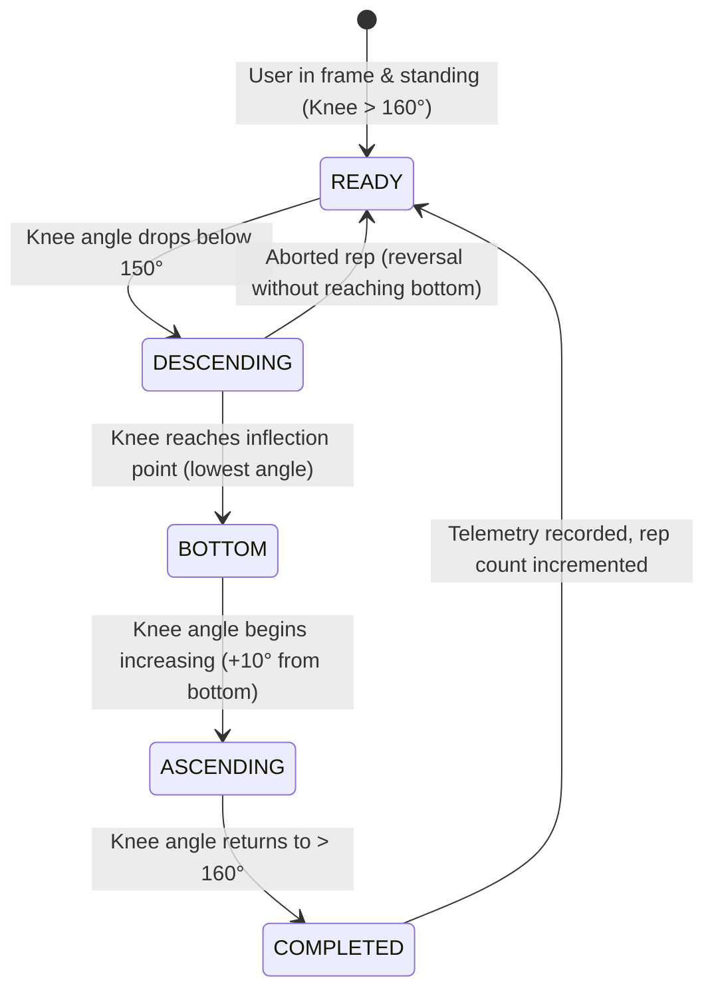

# FitLens Biomechanical Metric Formulations & Risk Heuristics

## 1. Landmark Representation

FitLens uses the **MediaPipe Pose 33-Keypoint Topology**. Coordinates are returned as normalized coordinates $(x, y, z)$ where:
- $x \in [0, 1]$ (horizontal position, left to right)
- $y \in [0, 1]$ (vertical position, top to bottom)
- $z$ represents approximate depth relative to the hip midpoint
- $v \in [0, 1]$ indicates landmark visibility confidence

Key Landmark Indices:
- Left / Right Shoulder: `11`, `12`
- Left / Right Hip: `23`, `24`
- Left / Right Knee: `25`, `26`
- Left / Right Ankle: `27`, `28`
- Left / Right Heel: `29`, `30`
- Left / Right Foot Index (Toes): `31`, `32`

---

## 2. Joint Angle Calculation Mathematics

To calculate the interior angle $\theta$ formed by three sequential 2D/3D points $A$, $B$, and $C$ (where $B$ is the joint vertex):

$$\vec{u} = \vec{A} - \vec{B}$$
$$\vec{v} = \vec{C} - \vec{B}$$

$$\cos(\theta) = \frac{\vec{u} \cdot \vec{v}}{\|\vec{u}\| \|\vec{v}\|}$$
$$\theta = \arccos\left(\text{clamp}\left(\frac{\vec{u} \cdot \vec{v}}{\|\vec{u}\| \|\vec{v}\|}, -1.0, 1.0\right)\right) \times \frac{180^\circ}{\pi}$$

### Primary Angles
1. **Knee Flexion Angle** ($\theta_{\text{knee}}$):
   - Vertex: Knee ($B$)
   - Arms: Hip ($A$) and Ankle ($C$)
   - Standing straight: $\sim 170^\circ - 180^\circ$
   - Parallel Squat depth: $\le 90^\circ$
2. **Hip Flexion Angle** ($\theta_{\text{hip}}$):
   - Vertex: Hip ($B$)
   - Arms: Shoulder ($A$) and Knee ($C$)
3. **Trunk Lean Angle** ($\theta_{\text{trunk}}$):
   - Angle between the vector from Hip $\rightarrow$ Shoulder and the true vertical axis $(0, -1)$.
   - $\theta_{\text{trunk}} = \arctan2(|x_s - x_h|, |y_s - y_h|) \times \frac{180^\circ}{\pi}$

---

## 3. Exercise Repetition State Machine

Each exercise implements a Finite State Machine (FSM) to prevent false repetition counts and track movement tempo (concentric/eccentric phase durations):

---

## 4. Movement Heuristics & Injury-Risk Scoring

> **Important**: All criteria below represent coaching heuristic indicators of movement efficiency and biomechanical strain. They are **not** clinical diagnoses.

### A. Squat Assessment

| Metric | Measurement / Formula | Interpretation | Concern Level |
| :--- | :--- | :--- | :--- |
| **Squat Depth** | Minimum Knee Angle $\theta_{\text{knee}}$ | - Optimal: $75^\circ - 95^\circ$ - Shallow: $> 100^\circ$ - Extreme Deep: $< 65^\circ$ | Low (Optimal) / Moderate (Shallow or Extreme under load) |
| **Knee Valgus (Inward Knee Cave)** | Normalized knee horizontal displacement relative to ankle-hip baseline: $V = \frac{x_{\text{knee}} - x_{\text{ankle}}}{x_{\text{hip}} - x_{\text{ankle}}}$ | Medial collapse of knee past vertical axis during ascending phase | **Moderate Concern** (Mild cave) **Elevated Concern** (Severe cave $< -0.05$ normalized offset) |
| **Excessive Forward Trunk Lean** | Trunk angle $\theta_{\text{trunk}}$ relative to vertical | - Normal: $15^\circ - 35^\circ$ - Excessive: $> 45^\circ$ | **Moderate Concern** (Increased lumbar shear stress) |
| **Left-Right Asymmetry** | $\Delta = |\theta_{\text{left\_knee}} - \theta_{\text{right\_knee}}|$ | - Symmetric: $\Delta < 8^\circ$ - Moderate asymmetry: $8^\circ - 15^\circ$ - High asymmetry: $> 15^\circ$ | **Elevated Concern** if persistent across multiple reps |

### B. Lunge Assessment

| Metric | Measurement | Interpretation | Concern Level |
| :--- | :--- | :--- | :--- |
| **Front Knee Angle** | $\theta_{\text{front\_knee}}$ at peak descent | Target: $85^\circ - 100^\circ$ | Low |
| **Front Knee Overreach** | Horizontal coordinate of knee relative to front toe ($x_{\text{knee}} > x_{\text{toe}} + \delta$) | Patellofemoral stress indicator | **Moderate Concern** if knee travels significantly beyond toe plane |
| **Torso Upright Alignment** | $\theta_{\text{trunk}}$ relative to vertical | Target: $< 20^\circ$ lean | **Moderate Concern** if $> 25^\circ$ |

### C. Jump & Landing Assessment

| Metric | Measurement | Interpretation | Concern Level |
| :--- | :--- | :--- | :--- |
| **Landing Knee Valgus** | Inward medial knee displacement within 200ms of touchdown | High indicator of dynamic ACL loading strain | **Elevated Concern** |
| **Landing Symmetry** | Difference in left vs. right knee flexion at ground contact | Asymmetrical ground reaction force distribution | **Moderate Concern** ($\Delta > 10^\circ$) |
| **Stiff Landing** | Minimum knee flexion $> 130^\circ$ upon landing | High impact shock absorption through joints rather than muscles | **Moderate Concern** |

---

## 5. Corrective Feedback Engine

When risk indicators trigger, FitLens displays non-diagnostic educational suggestions:
- **Knee Valgus**: "Focus on driving knees outward in line with your 2nd toe; strengthen hip abductors and gluteus medius (e.g. banded monster walks)."
- **Excessive Forward Lean**: "Keep chest proud, engage core, and check ankle dorsiflexion mobility."
- **Asymmetrical Shift**: "Ensure even weight distribution between both feet; practice unilateral split squats to address bilateral imbalances."

