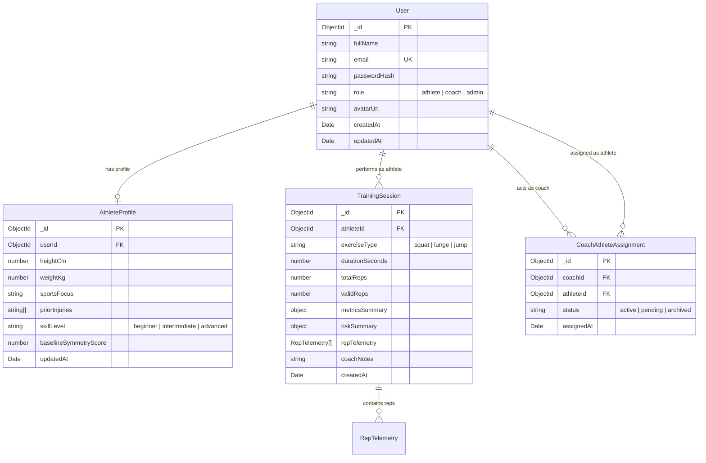

# FitLens Database Design & Mongoose Schema Specification

## 1. Overview

FitLens stores structured user accounts, athlete profiles, high-resolution training session summaries, repetition-level biomechanical telemetry, and coach-athlete assignments.
Raw video footage and raw camera buffers are **never stored** in the database. Only derived biomechanical metrics, heuristic risk flags, and exercise statistics are persisted.

---

## 2. Entity-Relationship Diagram



---

## 3. Schema Definitions

### 3.1. `User` Schema
```javascript
import mongoose from 'mongoose';

const userSchema = new mongoose.Schema(
  {
    fullName: {
      type: String,
      required: [true, 'Full name is required'],
      trim: true,
      maxlength: [80, 'Full name cannot exceed 80 characters'],
    },
    email: {
      type: String,
      required: [true, 'Email is required'],
      unique: true,
      lowercase: true,
      trim: true,
      match: [/^\S+@\S+\.\S+$/, 'Please enter a valid email address'],
    },
    password: {
      type: String,
      required: [true, 'Password is required'],
      minlength: [8, 'Password must be at least 8 characters'],
      select: false, // Never return password hash by default
    },
    role: {
      type: String,
      enum: ['athlete', 'coach', 'admin'],
      default: 'athlete',
      index: true,
    },
    isActive: {
      type: Boolean,
      default: true,
    },
  },
  {
    timestamps: true,
  }
);

userSchema.index({ email: 1 });
```

### 3.2. `AthleteProfile` Schema
```javascript
const athleteProfileSchema = new mongoose.Schema(
  {
    user: {
      type: mongoose.Schema.Types.ObjectId,
      ref: 'User',
      required: true,
      unique: true,
      index: true,
    },
    heightCm: {
      type: Number,
      min: [50, 'Invalid height'],
      max: [260, 'Invalid height'],
    },
    weightKg: {
      type: Number,
      min: [20, 'Invalid weight'],
      max: [300, 'Invalid weight'],
    },
    sportsFocus: {
      type: String,
      enum: ['basketball', 'soccer', 'running', 'powerlifting', 'crossfit', 'general_fitness'],
      default: 'general_fitness',
    },
    skillLevel: {
      type: String,
      enum: ['beginner', 'intermediate', 'advanced'],
      default: 'intermediate',
    },
    priorInjuries: [
      {
        bodyPart: { type: String }, // e.g. "Left ACL", "Lumbar spine"
        year: { type: Number },
        notes: { type: String },
      },
    ],
    baselineSymmetryScore: {
      type: Number,
      min: 0,
      max: 100,
      default: 100,
    },
  },
  {
    timestamps: true,
  }
);
```

### 3.3. `TrainingSession` Schema
```javascript
const repTelemetrySchema = new mongoose.Schema({
  repNumber: { type: Number, required: true },
  minKneeAngle: { type: Number, required: true },
  maxTrunkAngle: { type: Number, required: true },
  valgusDeviation: { type: Number, default: 0 },
  concentricDurationSec: { type: Number, default: 0 },
  eccentricDurationSec: { type: Number, default: 0 },
  formScore: { type: Number, min: 0, max: 100, default: 100 },
  flags: [{ type: String }], // e.g. ["valgus_moderate", "forward_lean"]
});

const trainingSessionSchema = new mongoose.Schema(
  {
    athlete: {
      type: mongoose.Schema.Types.ObjectId,
      ref: 'User',
      required: true,
      index: true,
    },
    exerciseType: {
      type: String,
      enum: ['squat', 'lunge', 'jump'],
      required: true,
      index: true,
    },
    durationSeconds: {
      type: Number,
      required: true,
      min: 1,
    },
    totalReps: {
      type: Number,
      default: 0,
      min: 0,
    },
    validReps: {
      type: Number,
      default: 0,
      min: 0,
    },
    metricsSummary: {
      averageKneeAngle: { type: Number },
      averageTrunkAngle: { type: Number },
      averageTempoSeconds: { type: Number },
      symmetryScore: { type: Number, min: 0, max: 100 },
      movementQualityScore: { type: Number, min: 0, max: 100 },
    },
    riskSummary: {
      overallConcernLevel: {
        type: String,
        enum: ['low', 'moderate', 'elevated'],
        default: 'low',
        index: true,
      },
      flaggedCount: { type: Number, default: 0 },
      indicators: [
        {
          type: { type: String }, // e.g. "knee_valgus", "excessive_lean", "landing_shock"
          severity: { type: String, enum: ['low', 'moderate', 'elevated'] },
          repOccurrences: [{ type: Number }],
          explanation: { type: String },
          suggestedCorrection: { type: String },
        },
      ],
    },
    repTelemetry: [repTelemetrySchema],
    coachNotes: {
      type: String,
      maxlength: 1000,
    },
    isDemo: {
      type: Boolean,
      default: false,
    },
  },
  {
    timestamps: true,
  }
);

// Compound index for querying athlete session history chronologically
trainingSessionSchema.index({ athlete: 1, createdAt: -1 });
trainingSessionSchema.index({ athlete: 1, exerciseType: 1 });
```

### 3.4. `CoachAthleteAssignment` Schema
```javascript
const coachAthleteAssignmentSchema = new mongoose.Schema(
  {
    coach: {
      type: mongoose.Schema.Types.ObjectId,
      ref: 'User',
      required: true,
      index: true,
    },
    athlete: {
      type: mongoose.Schema.Types.ObjectId,
      ref: 'User',
      required: true,
      index: true,
    },
    status: {
      type: String,
      enum: ['active', 'pending', 'archived'],
      default: 'active',
      index: true,
    },
  },
  {
    timestamps: true,
  }
);

coachAthleteAssignmentSchema.index({ coach: 1, athlete: 1 }, { unique: true });
```

---

## 4. Query Patterns & Indexing Strategy

1. **Athlete Dashboard Recent Sessions**:
   - Query: `TrainingSession.find({ athlete: userId }).sort({ createdAt: -1 }).limit(10)`
   - Covered by index: `{ athlete: 1, createdAt: -1 }`
2. **Athlete Performance Trends Over Time**:
   - Query: `TrainingSession.find({ athlete: userId, createdAt: { $gte: startDate } }).select('metricsSummary riskSummary createdAt')`
   - Covered by index: `{ athlete: 1, createdAt: -1 }`
3. **Coach Athlete Roster & History Review**:
   - Query: Verify assignment with `{ coach: coachId, athlete: athleteId, status: 'active' }`, then query sessions.
   - Guarded by composite unique index: `{ coach: 1, athlete: 1 }`.

